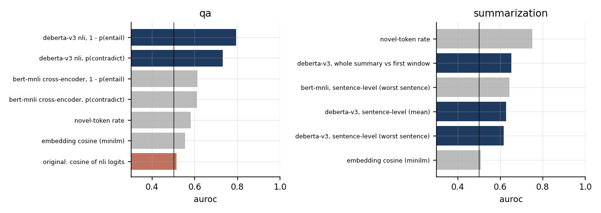
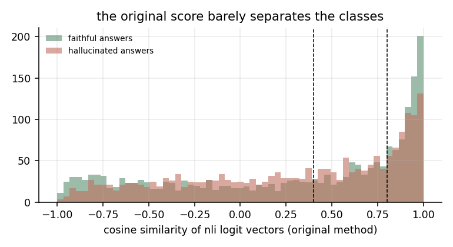
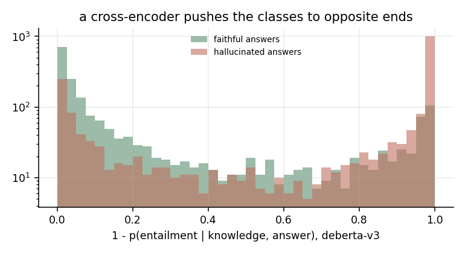

# Semantic LLM Hallucination Detection

A tool that checks an LLM's answer against trusted source text, plus a benchmark of how well that kind of check actually works.

- **The app** (`detection.py`, `model_tuning.py`): a Flask app that splits an answer into clauses, scores each clause against ground-truth statements with a BERT model fine-tuned on MNLI, and flags contradictions. Demo videos are linked at the bottom.
- **The benchmark** (`benchmark/`): the app's scoring method and five alternatives, evaluated on [HaluEval](https://arxiv.org/abs/2305.11747), where every item has a faithful and a hallucinated answer to the same question.

## Benchmark results

### Question answering (2,000 questions, 4,000 answers)

Each answer is scored against the knowledge passage. AUROC is the chance that a hallucinated answer scores higher than a faithful one; 0.5 is a coin flip.

| method | AUROC | accuracy (threshold from a dev split) |
|---|---|---|
| DeBERTa-v3 NLI cross-encoder, 1 − P(entailment) | **0.794** | 74.8% |
| DeBERTa-v3 NLI cross-encoder, P(contradiction) | 0.732 | 69.5% |
| BERT-MNLI cross-encoder, 1 − P(entailment) | 0.613 | 58.5% |
| novel-token rate (lexical baseline) | 0.581 | 55.0% |
| sentence-embedding cosine (MiniLM) | 0.554 | 54.9% |
| **the app's original score** (cosine of NLI logits) | **0.514** | 52.6% |



**The original scoring method is at chance.** It runs the evidence and the answer through the classifier *separately* and compares their 3-way logit vectors by cosine similarity. But an NLI model only means something when it reads the premise and hypothesis *together*; the logits of a single sentence carry no entailment information. Its fixed thresholds (above 0.8 entailed, below 0.4 contradicted) label 46% of faithful answers and 49% of hallucinated ones as contradictions.



Using the same kind of model as intended, as a cross-encoder over (evidence, answer), already helps. A stronger NLI model helps much more.



### Summarization (200 documents, 400 summaries)

Here the evidence is a long news article, so each summary sentence is scored against overlapping windows of the document (the app's clause-level idea, done with a cross-encoder).

| method | AUROC |
|---|---|
| novel-token rate (lexical baseline) | **0.751** |
| DeBERTa-v3, whole summary vs first window | 0.651 |
| BERT-MNLI, sentence-level, worst sentence | 0.644 |
| DeBERTa-v3, sentence-level, mean | 0.627 |
| DeBERTa-v3, sentence-level, worst sentence | 0.617 |
| sentence-embedding cosine (MiniLM) | 0.507 |

**A word-overlap baseline beats every NLI method here.** HaluEval's hallucinated summaries tend to introduce words that never appear in the article, which a lexical check catches directly, while sentence-level NLI over long documents is noisy. Splitting into sentences did not beat scoring the whole summary. NLI is not a free win: on long evidence it needs better retrieval of the relevant passage than fixed windows.

## What I'd change in the app

1. Score (evidence, clause) pairs with a cross-encoder instead of comparing single-sentence logits.
2. Use P(entailment) and P(contradiction) directly instead of fixed cosine thresholds.
3. Add the lexical novelty check as a cheap second signal; on summaries it is the stronger one.

## Run it

```bash
pip install -r benchmark/requirements.txt
python -m benchmark.run     # ~40 min on an M-series Mac; qa scores are cached and reused
```

The app itself: `python model_tuning.py` to fine-tune BERT on MNLI, then `python detection.py` to start the server.

## Demo

Part 1 - [https://www.loom.com/share/899b9a132feb44528b725c442691fb10?sid=843cac8b-1b8e-4fb0-b715-a4777ce06a43](https://www.loom.com/share/899b9a132feb44528b725c442691fb10?sid=93d072e0-7f83-41eb-ac17-8ae9b36540a7)

Part 2 - [https://www.loom.com/share/899b9a132feb44528b725c442691fb10?sid=843cac8b-1b8e-4fb0-b715-a4777ce06a43](https://www.loom.com/share/3daa92240433491a8ad4ae1e7c77ef55?sid=36d34746-fd43-4a6e-85e6-45ea87527e49)

Part 3 - https://www.loom.com/share/e31e101f823e445ab0741d3147627a34?sid=3346848f-8a72-4305-9be5-cd4e5b087574
